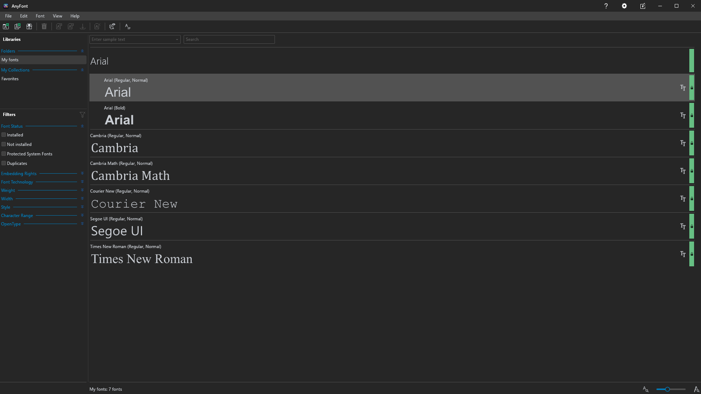

<p align="center">
  
</p>

<h1 align="center">AnyFont</h1>

<p align="center">
  <strong>A fast, friendly font manager for Windows.</strong>
</p>

<p align="center">
  <a href="https://github.com/toim22/AnyFont/releases/latest"></a>
  
  
  
</p>

<p align="center">
  <a href="https://github.com/toim22/AnyFont/releases/latest"><strong>Download AnyFont</strong></a>
  ·
  <a href="CHANGELOG.md">What's new</a>
  ·
  <a href="https://github.com/toim22/AnyFont/issues">Report a bug or share an idea</a>
</p>

<p align="center">
  
</p>

---

## Why AnyFont

Fonts pile up: the ones Windows came with, the ones you installed for one project years ago, folders full of
downloads you never installed. AnyFont puts all of them in one window. You can browse, preview, install and
organize them without opening the Fonts folder or a single font file.

- **Everything in one list.** Installed fonts and fonts in your own folders, side by side, with each font's name
  drawn in the font itself.
- **Install without the risk.** Install a font for every user of the PC with one Windows permission prompt, or, if
  you'd rather not give that permission, only for yourself. Uninstall it again with one click. Windows' own system
  fonts are protected.
- **Organized your way.** Folders, collections and Favorites, filters, search, grouping by family and a list of the
  fonts you used recently.
- **Fast and lightweight.** A single native Windows program written in Rust. No account, no sign-in, no subscription.
- **Your language.** The interface is available in 15 languages.
- **Always up to date.** AnyFont checks for new versions in the background and installs them when you ask.

## Features

### Browse and preview
- One list of installed and not-installed fonts, grouped by family, with each name drawn in its own font.
- Preview any text at any size, and switch between font names and Latin names.
- Font properties: every glyph, the font information (family, style, file, version, technology, code pages, weight,
  width) and the axes of variable fonts.

### Organize
- Libraries: add folders, build collections and mark Favorites. Export and import folders and collections.
- Filters, search and the recently used fonts.
- Find duplicate fonts, and find similar fonts by their PANOSE classification, with substitutions and exceptions.

### Install and clean up
- Install fonts for all users (one Windows permission prompt per operation), or only for yourself when you cancel
  that prompt; uninstall fonts installed either way.
- Delete font files to the Recycle Bin, or open their location in Explorer.
- Get more fonts: an online catalog of open-licence fonts (Google Fonts). Downloads go to the AnyFont Content
  folder (`Documents\AnyFont\Content\Fonts`), ready to install.

## Install

1. Download `AnyFont-<version>-setup.exe` from the [latest release](https://github.com/toim22/AnyFont/releases/latest).
2. Run it. No administrator rights are needed, because AnyFont installs for your user by default. You can also
   choose to install it for all users.
3. Choose the language AnyFont should start in.

The setup can also add AnyFont to "Open with" for font files (`.ttf`, `.otf`, `.ttc`). It never replaces the
program that opens them by default. Uninstalling AnyFont keeps your fonts installed and keeps your settings,
libraries and the Content folder.

Prefer no installer? The release also has a portable `AnyFont-<version>-win-x64.zip`: unzip it and run
`anyfont.exe`.

**Requirements:** Windows 10 (1809) or later, or Windows 11, 64-bit.

## Build from source

You need [Rust](https://rustup.rs) (stable, the `x86_64-pc-windows-msvc` toolchain), the Visual Studio C++ build
tools and, to build the installer, [Inno Setup](https://jrsoftware.org/isinfo.php) 6.7 or later.

```bat
build.bat
```

This builds the release version and writes everything to `dist\`:

| Output | What it is |
| --- | --- |
| `dist\AnyFont\` | The program folder |
| `dist\AnyFont-<version>-win-x64.zip` | The portable package |
| `dist\AnyFont-<version>-setup.exe` | The installer (when Inno Setup is installed) |
| `dist\symbols\` | Debug symbols (not for distribution) |

Other commands: `build.bat test` runs the tests, `build.bat debug` makes a debug build in `target\debug`, and
`build.bat clean` deletes `target\` and `dist\`. With plain Cargo:

```bash
cargo build --release
```

```bash
cargo test --workspace
```

| Folder | What's inside |
| --- | --- |
| `crates/anyfont` | The Windows program: window, menus, font list, panels and dialogs |
| `crates/anyfont-core` | Fonts, font database, libraries, filters, search, duplicates and PANOSE matching |
| `crates/anyfont-sys` | Windows integration: installed fonts, install and uninstall, Recycle Bin |
| `xtask` | Build helpers (brand assets) |
| `installer` | The Inno Setup script and wizard images |
| `services/issue-relay` | The service that files bug reports from the program as GitHub issues |
| `scripts` | `licenses.ps1`, which writes `THIRD-PARTY-NOTICES.txt` |
| `docs` | Architecture, specifications and the release guide |

See [docs/RELEASING.md](docs/RELEASING.md) for how a version is released.

## Report a bug or share an idea

Use **Help ▸ Report a Bug** or **Help ▸ Submit Ideas and Feedback** inside AnyFont. You don't need a GitHub account.
You can also open an [issue](https://github.com/toim22/AnyFont/issues) here.

## License

Copyright © 2026 AnyFont Team. All rights reserved. AnyFont is proprietary software (see [LICENSE](LICENSE)). The
open-source components it includes are listed with their licenses in [THIRD-PARTY-NOTICES.txt](THIRD-PARTY-NOTICES.txt)
and in Help ▸ About AnyFont ▸ Legal Notices. Fonts are not part of AnyFont and keep their own licenses.
